# Awesome Local Semantic Search 🔍

  

  
  
  
  
  
  

---

## 🌟 Top Local Semantic Search Ecosystem

> **A Curated Directory of SaaS Solutions & Open-Source Projects for On-Device File Retrieval, Multimodal Embeddings, Local RAG, and Vector Search Engines.**  
> *Last updated: October 2026*

This repository indexes leading **SaaS platforms** and **open-source projects** designed for **Local Semantic Search**. These tools empower users and developers to locate personal documents, code, images, audio, and video by conceptual meaning rather than exact keywords or static folder hierarchies—leveraging multimodal embedding models and on-device vector indexes while preserving complete data privacy.

* **Top Enterprise SaaS**: Notion AI, Glean, Hebbia, Coveo.
* **Top Open-Source Systems**: RAGFlow, AnythingLLM, Khoj, Qdrant, Chroma, LanceDB, Reor, DigUp, SeaGOAT.

---

## 📑 Table of Contents

- [📊 Sector Overview & Market Dynamics](#-sector-overview--market-dynamics)
- [☁️ SaaS/Hosted Platforms](#️-saashosted-platforms)
- [💻 Open-Source GitHub Projects](#-open-source-github-projects)
- [🤝 How to Contribute](#-how-to-contribute)
- [💖 Support](#-support)
- [📈 Star History](#-star-history)
- [⚠️ Disclaimer](#️-disclaimer)

---

## 📊 Sector Overview & Market Dynamics

The global enterprise and cognitive search market is estimated at **$5.5B–$7.5B in 2025/2026** and projected to surpass **$14B+ by the early 2030s** at an 8–10% CAGR (with generative AI and semantic retrieval sub-segments growing above 15%). The sector is **moderately fragmented**: cloud hyper-scalers (Microsoft Azure AI Search, Google Cloud Vertex AI Search, AWS) capture broad corporate infrastructure workloads, but independent AI search engines and vertical cognitive specialists maintain enduring moats around complex multi-source connectors, zero-retention enterprise privacy, and high-precision financial/legal knowledge retrieval rather than tilting into a single "winner-take-all" monopoly.

---

## ☁️ SaaS/Hosted Platforms

| Platform | Company Scale (Valuation / Revenue) | Pricing (Starting Tier) | Free Tier / Trial Limits | Description |
| :--- | :--- | :--- | :--- | :--- |
| **[Notion AI](https://www.notion.com/product/ai)** | **~$11B–$12B valuation** (~$600M ARR) | **$20/member/month** (billed annually on Business plan) or $24/member/month (monthly) | **20 complimentary one-time AI responses** across workspace on Free/Plus tiers; no perpetual free AI allowance | AI layer for Notion workspaces covering Enterprise Search, meeting notes, research, and Q&A. Limited to workspace-connected knowledge. |
| **[Glean](https://www.glean.com/)** | **$7.2B valuation** (~$300M ARR) | **~$45/user/month** (estimated starting core seat license; contracts start at $25,000–$50,000/year minimum) | **No self-service free tier or trial**; vendor evaluations require sales-gated custom proof-of-concept (POC) demos | Cloud enterprise search and workplace assistant connecting across Slack, Google Drive, Jira, and enterprise apps. |
| **[Hebbia](https://www.hebbia.ai/)** | **$700M valuation** (~$30M–$48M ARR) | **$3,000/seat/year** (~$250/month, starting Lite/Consumer tier; Pro analyst tier at ~$10,000/seat/year) | **No self-service free tier or public trial**; pre-contract access strictly limited to negotiated sales pilots | AI research and matrix analysis platform tailored for finance, private equity, and legal document workflows. |
| **[Coveo](https://www.coveo.com/)** | **~$250M CAD market cap** (~$148M–$160M ARR) | **~$600/month** (estimated entry Base plan; standard ecosystem packages start at ~$990/month) | **14-day free trial** (desktop web setup, no credit card required); no ongoing perpetual free tier | AI relevance and search platform connecting multi-cloud, intranet, and enterprise systems at scale. |

---

## 💻 Open-Source GitHub Projects

*Open-source projects ranked in descending order by GitHub Stars.*

- **[RAGFlow](https://github.com/infiniflow/ragflow)**   
  **Deep document understanding & local RAG engine.** An open-source RAG engine based on deep document understanding that performs multimodal semantic search, table understanding, and citation-grounded retrieval across complex PDFs, slides, and office formats with zero hallucination.

- **[AnythingLLM](https://github.com/Mintplex-Labs/anything-llm)**   
  **All-in-one local desktop AI & document search.** A private, full-stack desktop application that turns any document, PDF, media, or directory into a searchable vector index with local LLM support (Ollama, LM Studio, LocalAI) and built-in vector database management.

- **[Khoj](https://github.com/khoj-ai/khoj)**   
  **Personal AI assistant and local knowledge search.** An open-source, personal semantic search assistant running locally. Indexes your local Markdown notes, PDFs, org-mode files, GitHub repositories, and image directories for instantaneous natural language retrieval and agentic workflows.

- **[Qdrant](https://github.com/qdrant/qdrant)**   
  **High-performance vector search engine & database.** Production-ready vector similarity search engine written in Rust. Provides extended filtering support, payload storage, and fast local or self-hosted deployment for on-device semantic search pipelines.

- **[Chroma](https://github.com/chroma-core/chroma)**   
  **AI-native open-source embedding database.** Designed from the ground up for Python and JavaScript developers to embed search, semantic memory, and document indexing directly into local applications with zero external infrastructure.

- **[LanceDB](https://github.com/lancedb/lancedb)**   
  **Developer-friendly, serverless vector database.** Built on top of the Lance columnar format, LanceDB delivers ultra-fast local disk-based vector search and hybrid FTS without requiring a standalone daemon or persistent service.

- **[Reor](https://github.com/reorproject/reor)**   
  **Local-first AI note-taking and semantic search app.** An open-source desktop PKM application built on Llama.cpp and Transformers.js that automatically embeds all notes, links related thoughts semantically, and enables local offline Q&A.

- **[DigUp](https://github.com/ARahim3/DigUp)**   
  **Multimodal local search app for desktop.** Built on Google DeepMind's **EmbeddingGemma 2**, mapping text, images, screenshots, audio, and video into a unified vector space. Runs 100% locally on macOS, Linux, and Windows with optional natural language code search.

- **[SeaGOAT](https://github.com/kantord/SeaGOAT)**   
  **Local-first semantic code search engine for the terminal.** Leverages on-device vector embeddings (ChromaDB + SentenceTransformers) to enable natural language querying across git repositories directly from command line interfaces.

- **[Recall](https://github.com/pdstn12/Recall)**   
  **Linux-native multimodal semantic retrieval with OCR.** Built on EmbeddingGemma 2 via llama.cpp. Adds OCR for scanned PDFs and screenshots, presentation decks, spreadsheets, and precise deep-linking into document pages and video timestamps.

- **[vstash](https://github.com/stffns/vstash)**   
  **Lightweight document memory with hybrid search.** FastEmbed + sqlite-vec in a single zero-dependency SQLite database file. Implements Reciprocal Rank Fusion (BM25 + vector similarity) and optional local LLM question answering.

- **[dokosa](https://github.com/sile/dokosa)**   
  **Command-line semantic search tool for Git repositories.** An offline CLI tool written in Rust to index and search codebases and commit histories semantically with local embedding generation.

- **[cairnsearch](https://github.com/smwaqas89/cairnsearch)**   
  **Research-backed hybrid search and local RAG system.** SQLite FTS5 BM25 combined with Ollama dense embeddings, cross-encoder reranking, and built-in PII detection safeguards for private document archives.

---

### 🔧 Additional Tools & Specialized Frameworks

- **[LSS (Local Semantic Search)](https://pypi.org/project/local-semantic-search/)** — Hybrid BM25 + embeddings CLI featuring local file watching (`lss-sync`), file filtering, and offline execution via `bge-small-en-v1.5`.
- **[DeskSearch](https://pypi.org/project/desksearch/)** — Desktop GUI with system tray integration and hotkey search, pairing Tantivy BM25 with FAISS vector retrieval.
- **[PKMRAG](https://pypi.org/project/pkmrag/)** — Knowledge-graph-boosted hybrid search and Model Context Protocol (MCP) server combining LanceDB, Tantivy, and property graphs for Obsidian vaults.
- **vectile** — Desktop engine unifying Obsidian vaults, Calibre ebook libraries, and Git history with an MCP server for local AI agents.

---

## 🤝 How to Contribute

Contributions are warmly welcome! To propose additions or updates:

1. 🍴 **Fork** this repository.
2. 🌿 Create a descriptive branch (`git checkout -b add-my-search-project`).
3. 📝 Update `README.md` following the existing format (include name, links, description, star badges, and pricing details if SaaS).
4. 🚀 Submit a **Pull Request** with a brief summary of the project.

---

## 💖 Support

If you find this curated collection valuable for your local AI workflows, please consider:
- ⭐ **Starring** the repository to boost visibility.
- 🍴 **Forking** and contributing your favorite local search tools.
- 📢 Sharing it with colleagues, developers, and privacy advocates.
- ☕ Sponsoring the maintainer or buying a coffee on the [**GitHub Sponsors Dashboard**](https://github.com/sponsors/ishandutta2007).

---

## 📈 Star History

---

## ⚠️ Disclaimer

- This is an independent, **community-curated** directory—listings do not constitute formal endorsements.
- **Local-first definition**: Search indexes, vector databases, and embeddings stay strictly on your device. Verify individual project network calls (such as initial model downloads, update checks, or optional remote inference).
- **Hardware considerations**: Multimodal vector indexing and local LLMs may require sufficient RAM and GPU acceleration for large image, audio, or video datasets.

---

  Made with ❤️ for privacy-conscious developers, researchers, and anyone who believes finding a file shouldn't require remembering what it was named.

